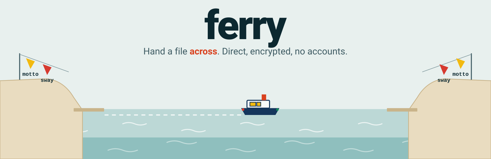

<p align="center">
  <picture>
    <source media="(prefers-color-scheme: dark)" srcset="docs/media/banner-dark.svg">
    
  </picture>
</p>

<p align="center">
  <a href="https://zahakj.github.io/ferry/">Site</a> ·
  <a href="https://zahakj.github.io/ferry/docs/quickstart.html">Quick start</a> ·
  <a href="https://zahakj.github.io/ferry/docs/pairing.html">How it works</a> ·
  <a href="https://zahakj.github.io/ferry/docs/mcp.html">For agents</a> ·
  <a href="https://github.com/ZahakJ/ferry/releases">Releases</a>
</p>

ferry sends files and messages between two machines, yours and a friend's,
or two of your own. One command prints a short code; the other machine
types it, and the file goes straight across, encrypted end to end, with
no accounts and no server in the middle. It is also a channel between two
Claude Code sessions on two machines.

```sh
curl -fsSL https://zahakj.github.io/ferry/install.sh | sh
```

<p align="center">
  <picture>
    <source media="(prefers-color-scheme: dark)" srcset="docs/media/demo-dark.svg">
    
  </picture>
</p>

## What you get

- **One code, one try.** Codes are three short words; a wrong guess burns
  the code on both sides, and the words never cross the network.
- **Direct, or not at all.** Data goes machine to machine, never through a
  server. When no direct path exists, ferry says so and what will fix it.
- **Fast on long, lossy lines.** A transfer runs over up to 16 connections
  at once: 0.64–0.69 Gbit/s on a 40 ms path with 0.5% loss, where one TCP
  stream manages 0.4.
- **Resumes and verifies.** Every 256 KiB piece and every whole file is
  checked with BLAKE3. Tested with 20 GiB files killed part way.
- **Pair once, then use names.** `ferry send sam ./photos`. Messages to a
  friend who is offline wait, sealed, until they are back.
- **Built for agents.** An MCP server, `--json` on every command, stable
  exit codes, and a manual written for models. What arrives is data, never
  orders.
- **One static binary.** Linux and macOS, Intel and ARM, nothing else to
  install.

## First run

```sh
ferry send ./holiday.mp4
```

It prints a code like `7-acorn-tulip-otter`. On the other machine:

```sh
ferry get 7-acorn-tulip-otter
```

Both screens show the same two check words; then the file crosses, is
checked byte for byte, and lands under its own name.

To skip codes from then on, pair once:

```sh
ferry pair                      # prints a code; your friend runs: ferry pair <code>
ferry send sam ./photos
ferry msg sam "pushed branch x, have a look"
ferry inbox
```

`ferry up` keeps a machine reachable in the background, and `ferry check`
says what works on your network.

## For Claude Code and other agents

```sh
claude mcp add ferry -s user -- ferry mcp
```

Two sessions on two paired machines can then message each other, wait for
replies, and hand over files and patches. Shell-only agents get the same
from the CLI: `ferry help --llm` prints a one-page manual written for a
model. See [ferry for agents](https://zahakj.github.io/ferry/docs/mcp.html).

## Your own rendezvous

A small server introduces the two machines; it never sees what you send.
ferry ships pointing at a public one. To run your own, use
[deploy/fly](deploy/fly) or any machine with a public address, and point
both machines at it:

```sh
ferry config rendezvous /dns/rv.example.org/tcp/4001/p2p/12D3KooW...
```

If a router blocks the direct connection, forward one UDP port to the
machine behind it: `ferry config port 40000`.

## How it works

1. **Meet.** Both machines connect out to the rendezvous. The code's
   number is a meeting slot there; its words never leave your machine.
2. **Agree on a key.** CPace, a password-authenticated key exchange, turns
   the words into a strong key. Watching it, even as the rendezvous,
   reveals nothing about the words.
3. **Connect directly.** Sealed under that key, the machines swap WebRTC
   offers carrying their encryption keys' fingerprints, then punch through
   both routers.
4. **Move and check.** The file is spread over several connections and
   hashed piece by piece; nothing gets its real name until it matches.

The whole story is in [How it works](https://zahakj.github.io/ferry/docs/pairing.html);
what each party can and cannot do is in the [threat model](SECURITY.md).

## Tested

`test/harness.sh` builds two homes behind NATs and a rendezvous inside a
user namespace, no root needed, and checks pairing, a wrong code refused,
a direct path through both NATs, a plain "no direct path" when UDP is
blocked, a forwarded port through strict NATs, no plaintext on the wire,
a 20 GiB file killed part way and resumed with a matching hash, and two
MCP clients talking. Throughput, measured the same way:

| path | ferry | one TCP stream |
|---|---|---|
| loopback, one machine | 2.0 Gbit/s | |
| LAN-like, through two NATs | 1.2–3.3 Gbit/s | |
| 40 ms round trip | 0.9–2.1 Gbit/s | 0.8 Gbit/s |
| 40 ms, 0.5% loss | 0.64–0.69 Gbit/s | 0.4 Gbit/s |

Method and raw numbers: [docs/throughput.md](docs/throughput.md).

## Docs

[Install](https://zahakj.github.io/ferry/docs/install.html) ·
[Quick start](https://zahakj.github.io/ferry/docs/quickstart.html) ·
[How it works](https://zahakj.github.io/ferry/docs/pairing.html) ·
[For agents](https://zahakj.github.io/ferry/docs/mcp.html) ·
[FAQ](https://zahakj.github.io/ferry/docs/faq.html) ·
[Protocol](https://zahakj.github.io/ferry/docs/protocol.html) ·
[CLI reference](https://zahakj.github.io/ferry/docs/cli.html) ·
[Security](SECURITY.md) · [Contributing](CONTRIBUTING.md) ·
[Changelog](CHANGELOG.md)

## License

MIT
